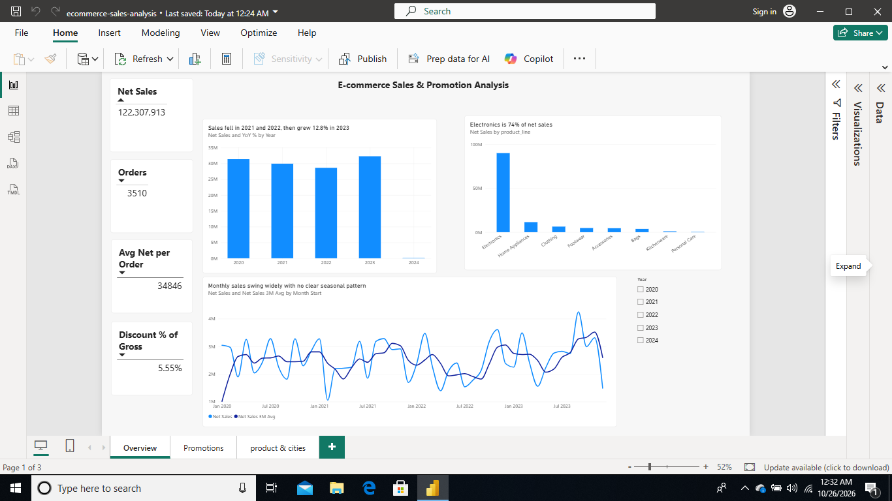
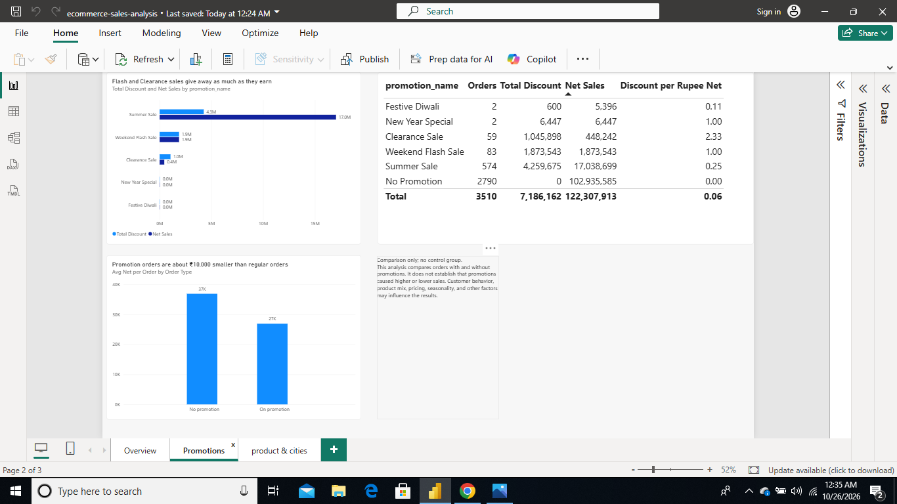
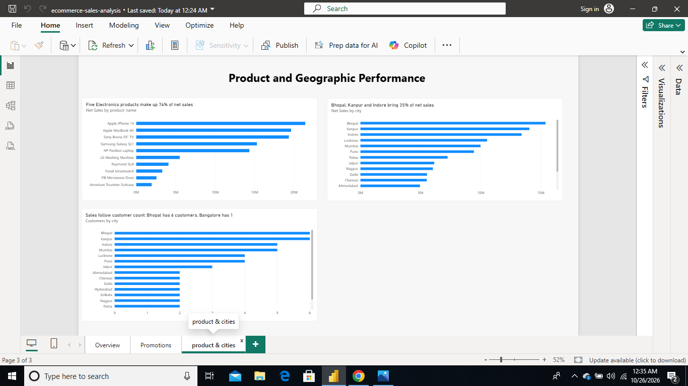

# E-commerce Sales & Promotion Analysis

**Author:** Akriti Kushwaha · [LinkedIn](https://www.linkedin.com/in/akritikushwaha) · [GitHub](https://github.com/AkritiTech) · akritikushwahaneha@gmail.com
**Tools:** MySQL 8, Power BI, Excel · **Skills shown:** joins, CTEs, window functions, data modelling, DAX, dashboard design




<!-- Add a screenshot of your Power BI Overview page at images/dashboard-overview.png -->

## The question

The dataset describes an online retailer selling across 16 Indian cities from 2020 to 2023 with five promotions. I approached it as a brief from the retailer's leadership, who want to know three things:

1. Is the business growing, and where does the revenue come from?
2. Are the promotions earning their discount cost?
3. Where should the team focus next?

## Data

3,510 orders, 50 customers, 30 products in 8 product lines, 16 cities, 5 promotions, January 2020 to December 2023 (one extra order on 1 January 2024, excluded from trend analysis). Currency is INR.
Source: public e-commerce sample dataset, [public sample e-commerce sales dataset].

I loaded it into four MySQL tables (`fact_sales` plus `dim_customers`, `dim_products`, `dim_promotions`), added a "No Promotion" row (`PR000`) so every order links to a promotion, trimmed padded city names, and checked that gross sales equal units × price and net equals gross minus discount on every row (0 errors).

## What I found

**1. Revenue is flat, and almost all of it is Electronics.**
Net sales were ₹12.23 crore over four years. Yearly sales went ₹3.14 cr (2020), ₹2.99 cr (2021, −4.5%), ₹2.86 cr (2022, −4.4%), ₹3.23 cr (2023, +12.8%), so 2023 is the first real recovery. Five products, all Electronics (iPhone 14, MacBook Air, Sony Bravia TV, Galaxy S21, HP Pavilion), make up 73.7% of net sales. Personal Care and Kitchenware together are 1.1%.

**2. The deep discounts give away as much as they earn.**
79.5% of orders had no promotion. Summer Sale (20% off) is the only promotion with real volume: 574 orders, ₹0.25 of discount per ₹1 of revenue. Weekend Flash Sale (50% off) gave ₹1.00 of discount per ₹1 of revenue. Clearance Sale (70% off) gave ₹2.33 per ₹1, meaning ₹10.5 lakh of discount for ₹4.5 lakh of revenue.

**3. Promotions did not make orders bigger.**
Promotion orders and regular orders both average 2.03 units and about ₹36,900 gross value. Customers who used a promotion did not buy more; they paid less (₹26,906 net vs ₹36,894). This is a comparison, not proof, because the data has no control group.

**4. Electronics also takes most of the discount budget.**
73.4% of all discount money (₹52.8 lakh of ₹71.9 lakh) went on Electronics, the line that sells well without help.

**5. City rankings mostly reflect how many customers a city has.**
Bhopal, Kanpur and Indore lead with 35.1% of sales together. But Bhopal has 6 customers and Bangalore has 1. Spend per customer is similar across cities (about ₹15.5 lakh to ₹36 lakh), so Bangalore and Hyderabad are not weak markets; they are small customer bases.

**6. No customer dependence, no clear seasonality.**
The top 10 of 50 customers account for 26.9% of sales. Monthly sales swing from ₹10.5 lakh (Feb 2021) to ₹42.5 lakh (Sep 2023) with no repeating pattern across the four years, so I do not claim a seasonal effect.

## Recommendations

1. **Cap discounts at around 20%.** Flash Sale returns ₹1 of revenue per ₹1 of discount, Clearance Sale less than ₹0.50, and neither raises basket size.
2. **Test before scaling Summer Sale.** Run it on half of customers or cities and compare, to find out whether the 20% discount creates extra sales or only discounts purchases that would have happened.
3. **Stop discounting Electronics by default.** Move discount budget to Home Appliances (9.4% of sales, led by the LG Washing Machine at ₹55 lakh) to grow the second line.
4. **Grow customers, not just sales per customer.** Bangalore and Hyderabad have 1 and 2 customers. Acquisition there is the lever.
5. **Review Personal Care and Kitchenware.** Together 1.1% of sales; consider bundling with Electronics purchases or trimming the range.

## Limitations

- Profit is exactly 10% of net sales on all 3,510 orders, which suggests simulated data. It adds no information, so I analysed revenue and discount cost instead of margin.
- Only 50 customers, so city and customer comparisons are small samples.
- Festive Diwali and New Year Special have 2 orders each; no conclusion is possible for them.
- No control group, so promotion effects are comparisons and not proof of cause.

## Dashboard

Three Power BI pages: **Overview** (KPIs, monthly trend, product-line mix), **Promotions** (discount cost vs revenue by promotion, promotion vs regular orders), **Products & Cities** (top-10 Pareto, city ranking). Slicers for year, city and product line.
File: `powerbi/ecommerce-sales-analysis.pbix`

## Repository

```
├── data/        cleaned CSVs (4 tables)
├── sql/
│   ├── 01_schema_and_load.sql   tables, keys, load instructions
│   └── 02_analysis.sql          14 queries, each with its business question
├── powerbi/     .pbix dashboard
├── images/      dashboard screenshots
└── README.md
```

## How to run

1. In MySQL 8+, run `sql/01_schema_and_load.sql`, then load the four CSVs from `data/` (Workbench Table Data Import Wizard, in the order the file lists).
2. Run `sql/02_analysis.sql`. Each query has a comment saying what it answers.
3. Open the `.pbix` in Power BI Desktop to explore the dashboard.
